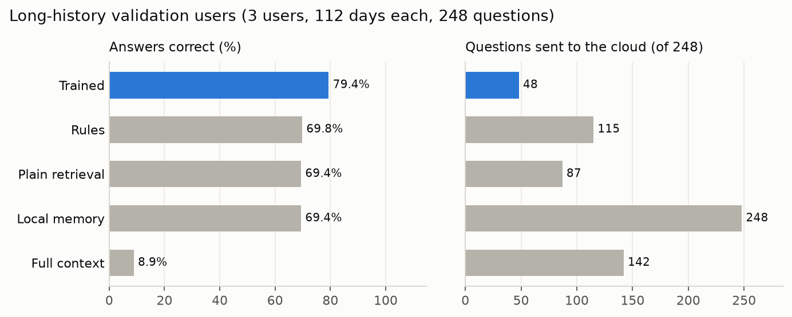
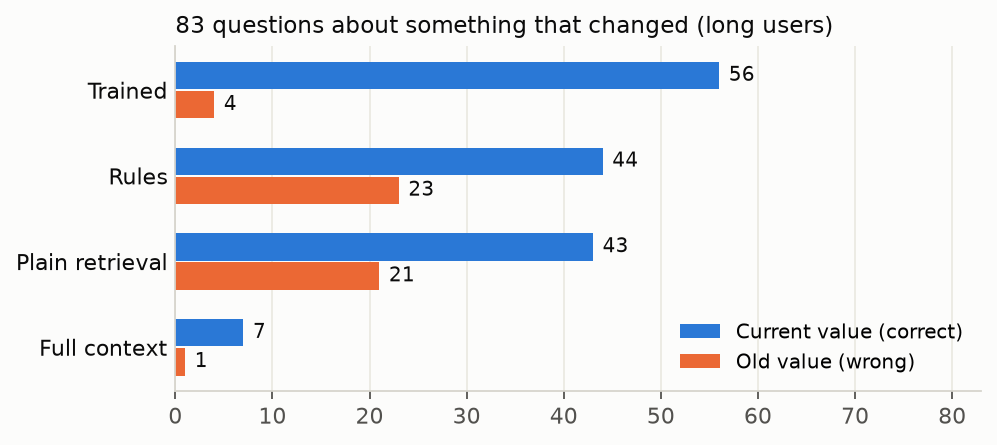
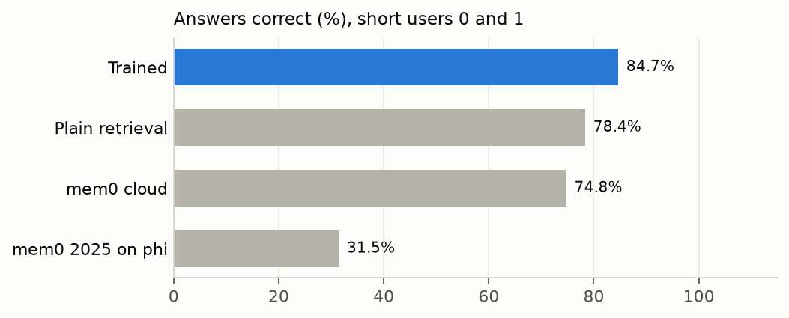
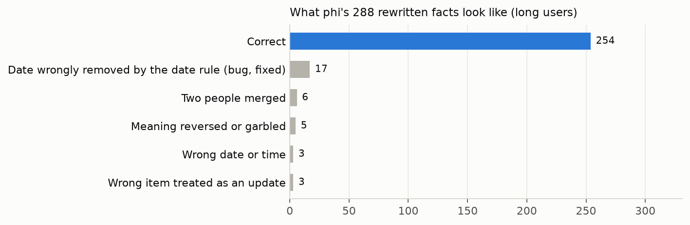

# InferX: decoupled memory control for on-device LLM agents

A personal assistant that remembers a phone's calendar, messages and purchases, running fully on a
Snapdragon X Elite laptop. **A small trained controller decides what goes into memory; the main LLM
(phi-3.5-mini) only writes facts and answers questions.** The same setup also runs on a Galaxy S25.

Speed and energy are not goals of the thesis.

## Results at a glance



On 3 simulated users with 4 months of history each (validation data, not the final test):

- **More correct answers:** 79.4% for trained against 69.4% for plain retrieval (+10.1 points,
  95% interval +3.2 to +16.5).
- **Far fewer out-of-date answers:** 4 replies gave an old value, against 21 for plain retrieval.
- **Under half the cloud use:** 48 of 248 questions sent to the cloud, against 87.
- **Secrets never saved:** all one-time codes were dropped. mem0's cloud service kept about 42 of 52.

On messages written by other models, the controller does much worse: update F1 falls from about 0.9 to
0.25, and 6 of 25 secrets get through (see "Messages written by other models").

## How it works

1. **A message arrives** and MiniLM turns it into 384 numbers that capture its meaning.
2. **The controller makes four decisions** from those numbers:

   | Decision | Question | If yes |
   |---|---|---|
   | sensitive | Is it a one-time code? | Dropped, never saved |
   | store | Is it worth remembering? | Queued to become a fact (if no, only the raw message is kept) |
   | kind | State, event, core fact or none? | Limits what it may replace |
   | replaces | Does it update a saved memory? | The old memory is marked outdated, never deleted |

3. **Rules check the "replaces" decision:** events are never replaced, only the same kind can
   replace each other, and someone else's news can't overwrite the owner's fact.
4. **At idle time, phi writes each queued message as one clear sentence.** For an update it merges
   old and new, so unchanged details (like the place) carry over.
5. **A question arrives:** the closest memories are found, outdated ones are hidden (or labelled
   "Out of date" for history questions), and phi answers.
6. **Cloud rule:** phi says whether its memories answer the question. Only a "no" goes to the cloud.

## Systems compared

All use the same LLM, answer prompt and cloud rule. Only memory differs.

| System | Memory | Who decides what's saved |
|---|---|---|
| **Trained** (proposed) | Facts + raw messages, outdated versions hidden | Small trained controller + rules |
| **Trained plus** | Same as trained | Trained + secret format rules, owner guard, phi decides unsure updates |
| **Rules** | Facts + raw messages | Keyword rules and similarity thresholds |
| **Plain retrieval** | Every raw message, nothing replaced | Nobody (everything is kept) |
| **Full context** | No store: only the latest ~3,000 tokens of messages | Nobody |
| **Local memory** | Like plain retrieval, but every question goes to the cloud | Nobody |
| **mem0 2025 on phi** | Facts only, raw messages discarded | phi, using mem0's prompts |
| **mem0 cloud** | mem0's hosted service; every message sent to mem0 | mem0's cloud models |

## Results

All results use phi-3.5-mini on the NPU (Foundry Local) and are **validation** numbers. The
held-out test users and LoCoMo conversations 2 to 9 stay untouched until the final comparison.

### Questions about something that changed



When a detail changes (an appointment moves, a friend changes jobs), plain retrieval finds both
versions and phi often picks the old one. Trained hides the outdated version.

### Long-history users (3 users, 112 days, 248 questions)

| | Plain | Full context | Local memory | Rules | Trained |
|---|---|---|---|---|---|
| Correct | 69.4% | 8.9% | 69.4% | 69.8% | **79.4%** |
| Changed detail answered correctly (83) | 43 | 7 | 43 | 42 | **60** |
| Old value given | 21 | 1 | 21 | 28 | **4** |
| History questions (9) | **7** | 0 | **7** | **7** | 5 |
| No-answer questions declined (15) | **14** | 3 | **14** | **14** | 13 |
| Sent to the cloud | 87 | 142 | 248 | 115 | **48** |

- The gain is uneven: +14 and +12 points on users 0 and 2, +4 on user 1.
- Full context scores low because only the last few days fit into phi's input.
- Runs `20261108-145846`, `161136`, `174426` (plain, full context, local memory) and
  `20261111-133302`, `144201`, `151422` (rules and trained, after the date fix).

### Short users (5 users, 268 questions)

| | Plain | Rules | Trained | mem0 on phi | mem0 cloud |
|---|---|---|---|---|---|
| Correct | 76.9% | 77.2% | **84.3%** | 29.9% | 73.9% |
| Changed detail answered correctly (72) | 44 | 45 | **60** | 14 | 41 |
| Old value given | 18 | 23 | **1** | 15 | 14 |

Trained minus plain retrieval: +7.5 points (+1.9 to +13.1). Rules and trained: runs
`20261111-111329` to `122157`.

These favour trained: its fixes were designed by reading errors on these same users.

### mem0



**On mem0's cloud models, mem0 works** (73.9%, close to plain retrieval's 76.9%; trained is
+10.4 points ahead, +4.5 to +16.4). **On phi it fails** (29.9%). mem0 asks the LLM to make every memory decision, and a small model does this badly:

1. **It keeps only what phi writes down.** Raw messages are discarded, so any mistake is permanent.
2. **phi's facts lose their subject:** "Event location: Warmline Services" is saved apart from the
   boiler inspection it belongs to.
3. **phi makes bad update decisions:** it overwrote unrelated memories and skipped new ones
   ("no change" ~1,160 times against 648 additions).
4. **Nothing checks phi:** no rules on what may replace what, and secrets are saved.

mem0's 2026 version can't run on phi at all: its prompt is too long (~9,500 tokens).
**mem0 cloud also kept about 42 of 52 one-time codes** sent to it (a keyword count of its memories, so
approximate); trained kept none. Its memory work took 1,151 requests and 13.8 MB.

### Making the controller generalize (no-LLM checks)

Three additions, in the `trained_plus` system (`--plus-options` switches each off for ablations).
`scripts/eval_generalize.py` measures them on labelled data without phi
([output](runs/eval_generalize.txt)):

| Addition | What it does | Effect on validation labels |
|---|---|---|
| Secret format rules (`inferx/sensitive.py`) | Drops card numbers (Luhn), IBANs (mod 97), passwords, PINs, one-time codes, SSNs, NI numbers, API keys | All 264 secrets caught, 0 false alarms in 2,066 messages and 5,882 LoCoMo messages |
| Owner guard | A first-person message ("my new cell") can't replace someone else's fact | Long users: wrong replacements 11 → 7, no real update lost |
| phi decides unsure updates | Update scores within 0.2 of the threshold, or updates between two differently named things, go to phi at idle time | Long users: 25 questions to phi, covering 10 of the 19 update errors |

- The secret rules were written while looking at misses in these sets, so their score is optimistic.
- A harder "different names block the update" rule was dropped: it also blocked real changes, such as a
  new employer (recall 0.86 → 0.76).
- The phi numbers are a ceiling: phi must also leave the 15 correct cases alone.

**With phi (validation, all three additions on):**

| | Long users (248 questions) | Short users (268 questions) |
|---|---|---|
| Correct: trained → trained_plus | 79.4% → **82.7%** | 84.3% → 84.3% |
| Difference (95% interval) | +3.2 (−0.4 to +6.9) | 0.0 (−2.6 to +2.6) |
| Stable facts correct | 86.2% → 89.7% | 90.5% → 92.1% |
| Old value given (changed details) | 4 → 7 (of 83) | 1 → 4 (of 72) |
| Updates sent to phi / phi said "replace" | 26 / 7 | 20 / 9 |

- trained_plus is ahead on all three long users (+1.1, +3.7, +4.8), but the interval still touches zero.
- The gain comes from fewer wrong replacements: evidence recall rises from 0.867 to 0.931, because facts
  that were wrongly overwritten now stay.
- The cost: phi says "replace" to only about a third of the unsure updates, so a few real changes are
  missed and the old value comes back. phi is too cautious here; a better prompt or a lower band is the next fix.
- The secret rules caught nothing extra in these runs: the trained head already dropped every secret (205 and 52).

### Messages written by other models (no-LLM checks)

Everything above uses this repo's own simulator. To test text it didn't write, free models in
[opencode](https://opencode.ai) wrote labelled timelines from [a short brief](data/external/brief.md),
in an empty folder that held only the brief, so they never saw this repo
([script](scripts/external_writer.ps1)). Each person has about 110 messages over weeks, with labels for
store, kind, update and secret.

- **Held-out test:** 5 people written by DeepSeek V4.1 Flash ([data](data/external/20261118-195649)).
  Scored once per controller, and nothing was tuned on it.
- **Training:** 14 people from 4 other writers (Nemotron 3.5 Super, Big Pickle, HY4 Flash and
  MiMo 2.6 Flash). 4 more people, one per writer, were used only to pick settings.
  One Nemotron batch was dropped before training, because it marked dozens of identical repeats as updates.
- **Controllers:**
  - The original controller.
  - A retrained one, trained on the simulator plus the outside people
    ([script](scripts/train_mixed_classifier.py)).
  - A hybrid: the original controller with only the retrained secret head swapped in
    ([script](scripts/build_hybrid_classifier.py)).
  - The retrained one lost a lot on the simulator people (update F1 0.95 → 0.75), so the hybrid went to the test.

| DeepSeek test (5 people, 75 updates, 25 secrets) | Original, CPU | Hybrid, CPU | Original, NPU | Hybrid, NPU |
|---|---|---|---|---|
| Store F1 | 0.80 | 0.80 | 0.80 | 0.80 |
| Update F1 | 0.25 | 0.25 | 0.24 | 0.23 |
| Secrets stored (rules and controller both missed) | 7 of 25 | **6 of 25** | 7 of 25 | **6 of 25** |
| Secret rules alone | 10 of 25 caught, 0 false alarms | same | same | same |
| Messages wrongly flagged as secret by the controller | 13 | 16 | 13 | 21 |

The laptop's NPU (`--npu`) and the Galaxy's NPU (`--galaxy`) give identical numbers. The small gap to the
CPU comes from running MiniLM on an NPU, which shifts a few close decisions. The final comparison runs on the
NPU, so the NPU columns are the ones to quote
(outputs: [CPU](data/external/20261118-195649/eval.json),
[CPU, hybrid](data/external/20261118-195649/eval_hybrid.json),
[laptop NPU](data/external/20261118-195649/eval_npu.json),
[laptop NPU, hybrid](data/external/20261118-195649/eval_npu_hybrid.json),
[phone](data/external/20261118-195649/eval_galaxy.json),
[phone, hybrid](data/external/20261118-195649/eval_galaxy_hybrid.json)).

| Validation (picks settings, not a test) | Original | Retrained | Hybrid |
|---|---|---|---|
| Outside people: update F1 | 0.27 | 0.30 | 0.25 |
| Outside people: secrets stored after rules | 15 of 36 | 4 of 36 | 8 of 36 |
| Simulator people: update F1 | 0.95 | 0.75 | 0.95 |
| Handwritten check: update F1 | 0.90 | 0.57 | 0.90 |

- **Updates don't carry over to outside text.** Update F1 falls from about 0.9 on the simulator to 0.25,
  and training on outside text didn't raise it. On validation, the writers seem to disagree on what counts
  as an update, and the small heads on MiniLM can't fit all of them. This is the controller's biggest open gap.
- **Secrets improved on validation, much less on the test.** Leaks on validation fell from 15 to 8, but
  on the test only from 7 to 6, so most of the gain didn't carry over to a new writer.
- **The secret rules miss formats they were meant to cover.** Of the 15 secrets they missed on the test,
  most are worded differently from the simulator's: "One-time code 906442 for your business payment",
  "password changed to Copper-Fern-917", a passport number, Aadhaar and CPF numbers, and Portuguese
  ("Senha temporária", "Código … para aprovar o PIX"). They weren't fixed from these misses, because that
  would tune the rules on the test. A fix needs new rules written from other text, followed by a fresh test.
- Two test labels look wrong (a106 ← a072, s048 ← s012). They were kept as the writer gave them.
- Validation numbers: [metrics.json](models/assistant_classifier_hybrid/metrics.json). The systems with phi
  still use the original controller.

### Fact quality



All 288 facts phi wrote for the long users were checked by hand against their messages. **88%
were correct.** Half the errors came from a bug in the date rule (correct dates written as
"21/4/2025" or "Apr 10" were deleted), fixed in commit `f8d6568`. After the fix, 104 of the 105
facts whose message gave a date keep it (89 before), so about 94% of facts are now correct
(estimated, not re-checked by hand). The rest: the controller linking two different people or
items (9), and phi garbling a meaning or time (8).

### Cloud check: does phi know when it needs help?

| Trained, long users | Answer was right | Answer was wrong |
|---|---|---|
| phi said "my memories answer it" (200) | 169 | **31 (never sent to the cloud)** |
| phi said "they don't" (48) | 28 (sent needlessly) | 20 |

The check catches only 20 of 51 wrong answers. Nothing checks the cloud's reply.

### Other checks

- **Controller on the NPU:** with only the decision heads on the NPU, every decision matched the
  CPU. With MiniLM on the NPU too, decisions shift slightly (updates found 4→5 of 7, one wrong
  overwrite). Validation runs used the CPU copy; the final comparison uses the NPU
  (`--npu-controller`).
- **Network:** Foundry Local keeps an encrypted connection to a Microsoft address during runs, so
  the "nothing leaves the device" claim needs the full packet capture (`scripts/capture_network.ps1`,
  admin needed).
- **LoCoMo conversation 1** (early check): rules beat plain retrieval with phi (score 0.385 vs 0.354).

### On the Galaxy S25

phi-3.5-mini and the trained controller (MiniLM and its 4 heads) both run on the phone's NPU
(Snapdragon 8 Elite, QAIRT 2.52), driven from the laptop over USB (`inferx/galaxy.py`, `--galaxy`).
phi is Qualcomm's w4a16 build for the 8 Elite, a different compressed copy of the same model than
Foundry's laptop build. Setup: `scripts/build_galaxy_models.py`.

- **Controller:** the phone makes the same decision as the laptop's NPU on **all 2,240 messages** of the
  8 validation users (store, kind, secret, replace), with store scores within 0.002
  ([`scripts/galaxy_check.py`](scripts/galaxy_check.py), [output](runs/galaxy_check.txt)).
  The hybrid controller matches on all 2,240 too ([output](runs/galaxy_check_hybrid.txt)), and on the
  DeepSeek test the phone gives the same numbers as the laptop's NPU.
- **End to end, short user 0:** the phone scores **46 of 55 (83.6%)**, the same as the laptop, with the same
  memory work (58 facts written, 18 updates, 16 secrets dropped) and no old values. Answers differ on 8
  questions, 4 each way, from phi's different build. The phone's phi asked the cloud for help more often (16 against 7).

## Limitations

- **Secrets:** the simulator's only secrets are one-time codes. Format rules (in `trained_plus`) add cards,
  passwords, PINs and ID numbers, but on outside-written text they caught only 10 of 25. Health details are
  kept on purpose.
- **History questions** are weaker (5 of 9 vs 7 of 9), because outdated versions are hidden.
- **Updates on text the simulator didn't write:** 9 of 10 found on the hand-written check, but update F1
  is only 0.25 on 5 people written by DeepSeek (about 0.9 on the simulator). See "Messages written by
  other models".

## Status

| Part | Status |
|---|---|
| Memory store, trained controller, rules, cloud rule, all baselines | Built |
| Controller on the NPU | Built, checked; used in the final run |
| Long-history comparison | Done |
| mem0 on phi, mem0 cloud | Done |
| `trained_plus` (generalization additions) | Built and validated: +3.2 on long users, level on short users |
| Real cloud LLM for the cloud rule | Works: Claude Opus 5.5 through its OpenAI-style endpoint; checked on short user 0 (7 cloud calls, 0 errors, about 1,400 input tokens each) |
| Letta | Not added yet |
| Messages written by other models | Done: 5 test people (DeepSeek), 18 training/validation people |
| Galaxy S25 | Built and checked: same controller decisions as the laptop |
| Final comparison with packet capture (`scripts/run_final.sh`) | Ready, not run: real cloud (Claude Sonnet 5.5, about $15-30); needs an administrator PowerShell for the capture |
| Final comparison on the Galaxy S25 | Not run |

## Setup (Windows ARM64)

Needs native ARM64 Python 3.12, the MSVC ARM64 build tools, the Windows SDK and Foundry Local.

```
python -m venv .venv
.venv\Scripts\python -m pip install -r requirements.txt
scripts\build_sqlite_vec.cmd
.venv\Scripts\python scripts\test_sqlite_vec.py
.venv\Scripts\python -m pytest tests
```

mem0 needs its own environment (its `grpcio` dependency has no Windows ARM64 build; the port
stubs the parts it imports, and switches off mem0's telemetry):

```
python -m venv .venv-mem0
.venv-mem0\Scripts\python -m pip install -r requirements.txt -r requirements-mem0.txt
.venv-mem0\Scripts\python -m pip install --no-deps mem0ai==2.2.1 qdrant-client==1.20.0
```

Downloaded, not stored here: the sqlite-vec v0.1.9 and SQLite 3.49.1 amalgamations
(`third_party/sqlite-vec`), `data/locomo/locomo10.json` (snap-research/locomo, CC BY-NC 4.0), and
all-MiniLM-L6-v2 (Apache 2.0) as `models/minilm/model_qint8_arm64.onnx` and
`models/minilm_fp32/model.onnx` (plus `model_fixed.onnx`, input fixed to 1 x 128 for the NPU).

## Run

```
foundry server start
foundry model load phi-3.5-mini
foundry server status
```

Use its Public API URL as `<URL>`, and phi's `tokenizer.json` from
`~/.foundry/cache/models/Microsoft/phi-3.5-mini-instruct-qnn-npu-3/v3/` as `<TOKENIZER>`.

```
.venv\Scripts\python scripts\generate_assistant_data.py [--long]
.venv\Scripts\python scripts\train_memory_classifier.py
.venv\Scripts\python scripts\tune_memory_thresholds.py
.venv\Scripts\python scripts\cloud_stub.py --port 8765 --log runs\cloud_stub.jsonl
.venv\Scripts\python scripts\run_locomo.py --url <URL> --model phi-3.5-mini-instruct-qnn-npu:3 --tokenizer <TOKENIZER> --data data\assistant\val.json --conversation 0 --cloud gate --systems plain_retrieval,full_context,local_memory,decoupled,trained
.venv\Scripts\python scripts\compare_assistant_runs.py runs\<run> [runs\<run> ...]
.venv\Scripts\python scripts\make_figures.py
```

- `--npu-controller` runs the controller on the NPU. `--galaxy` runs phi and the controller on the Galaxy
  over USB (no `--url` needed).
- Outside-written timelines: `scripts\external_writer.ps1` writes them, `scripts\eval_external.py` scores
  them (`--npu`, `--galaxy`, `--heads`).
- mem0: use `.venv-mem0\Scripts\python` with `--systems mem0_2025_local` or `mem0_cloud`.
- **Nothing leaves the laptop without `--allow-remote`.** Keys come from environment variables the
  user saves, never from this repository: `MEM0_API_KEY` (mem0 cloud) and `INFERX_CLOUD_API_KEY`
  (a real cloud LLM, with `--cloud-url` and `--cloud-model`).
- The cloud stand-in (`scripts/cloud_stub.py`) answers on 127.0.0.1 and logs each call's size.
- Real cloud: `--allow-remote --cloud-url https://api.anthropic.com/v1 --cloud-model claude-opus-5-5`. Run summaries count
  `cloud_errors` and the provider's token counts, and a run whose cloud calls failed ends with a WARNING line.
- Each run writes `runs/<timestamp>/` with its config, summary, every answer, and a log.

## Method notes

- Simulated data: 40 training, 5 validation and 10 test users; test users hold out every third
  name, item and template.
- A reply counts as correct if it contains the answer in any format. Intervals are 95% bootstrap
  intervals over questions.
- `data/assistant/handwritten*.json` were written by the developer, so they are not independent.
- Outside-written data is in `data/external/<batch>/`, each with the brief, the writer's logs and
  `writer.json`. `20261118-195649` is the held-out test.
- Left out of comparisons: stopped or smoke-test runs `20261108-135534`, `135621`, `141228`,
  `221518`, `20261109-134852` (mem0 user ID sent in the wrong field); mem0 runs `20261108-185536`
  to `213205` (broken reply parser); mem0 cloud runs `20261109-150122`, `154716`,
  `20261111-093053`, `093054` (laptop slept, network lost).
- Foundry's `completion_tokens` over-reports, so `inferx/llm.py` counts output chunks itself.
