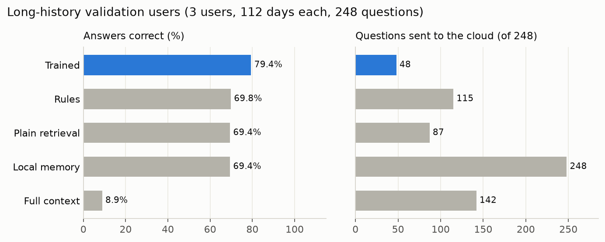
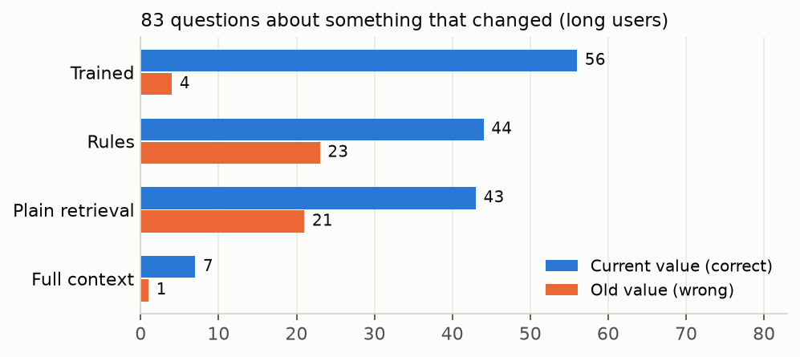
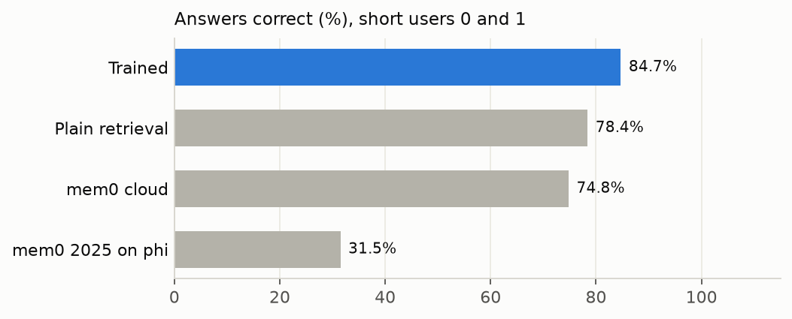
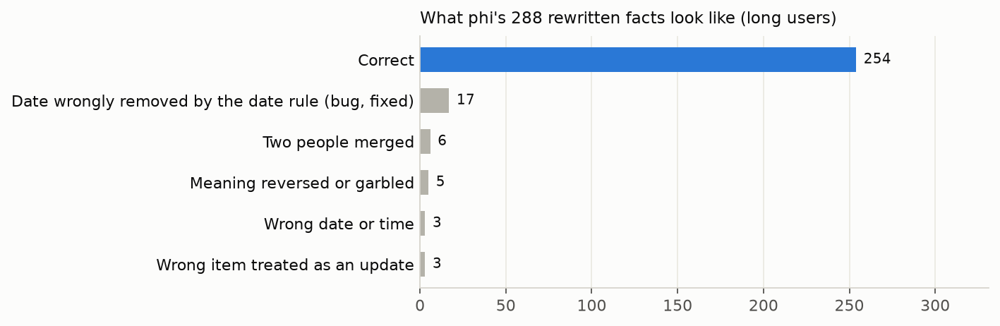

# InferX: decoupled memory control for on-device LLM agents

A personal assistant that remembers a phone's calendar, messages and purchases, running fully on a
Snapdragon X Elite laptop. **A small trained controller decides what goes into memory; the main LLM
(phi-3.5-mini) only writes facts and answers questions.** A Galaxy S25 build comes later.

Speed and energy are not goals of the thesis.

## Results at a glance



On 3 simulated users with 4 months of history each (validation data, not the final test):

- **More correct answers:** 79.4% for trained against 69.4% for plain retrieval (+10.1 points,
  95% interval +3.2 to +16.5).
- **Far fewer out-of-date answers:** 4 replies gave an old value, against 21 for plain retrieval.
- **Under half the cloud use:** 48 of 248 questions sent to the cloud, against 87.
- **Secrets never saved:** all one-time codes were dropped. mem0's cloud service kept about 42 of 52.

## How it works

1. **A message arrives** and MiniLM turns it into 384 numbers that capture its meaning.
2. **The controller makes four decisions** from those numbers:

   | Decision | Question | If yes |
   |---|---|---|
   | sensitive | Is it a one-time code? | Dropped, never saved |
   | store | Is it worth remembering? | Queued to become a fact (if no, only the raw message is kept) |
   | kind | State, event, core fact or none? | Limits what it may replace |
   | replaces | Does it update a saved memory? | The old memory is marked outdated, never deleted |

3. **Rules check the "replaces" decision:** events are never replaced, only the same kind can
   replace each other, and someone else's news can't overwrite the owner's fact.
4. **At idle time, phi writes each queued message as one clear sentence.** For an update it merges
   old and new, so unchanged details (like the place) carry over.
5. **A question arrives:** the closest memories are found, outdated ones are hidden (or labelled
   "Out of date" for history questions), and phi answers.
6. **Cloud rule:** phi says whether its memories answer the question. Only a "no" goes to the cloud.

## Systems compared

All use the same LLM, answer prompt and cloud rule. Only memory differs.

| System | Memory | Who decides what's saved |
|---|---|---|
| **Trained** (proposed) | Facts + raw messages, outdated versions hidden | Small trained controller + rules |
| **Trained plus** | Same as trained | Trained + secret format rules, owner guard, phi decides unsure updates |
| **Rules** | Facts + raw messages | Keyword rules and similarity thresholds |
| **Plain retrieval** | Every raw message, nothing replaced | Nobody (everything is kept) |
| **Full context** | No store: only the latest ~3,000 tokens of messages | Nobody |
| **Local memory** | Like plain retrieval, but every question goes to the cloud | Nobody |
| **mem0 2025 on phi** | Facts only, raw messages discarded | phi, using mem0's prompts |
| **mem0 cloud** | mem0's hosted service; every message sent to mem0 | mem0's cloud models |

## Results

All results use phi-3.5-mini on the NPU (Foundry Local) and are **validation** numbers. The
held-out test users and LoCoMo conversations 2 to 9 stay untouched until the final comparison.

### Questions about something that changed



When a detail changes (an appointment moves, a friend changes jobs), plain retrieval finds both
versions and phi often picks the old one. Trained hides the outdated version.

### Long-history users (3 users, 112 days, 248 questions)

| | Plain | Full context | Local memory | Rules | Trained |
|---|---|---|---|---|---|
| Correct | 69.4% | 8.9% | 69.4% | 69.8% | **79.4%** |
| Changed detail answered correctly (83) | 43 | 7 | 43 | 42 | **60** |
| Old value given | 21 | 1 | 21 | 28 | **4** |
| History questions (9) | **7** | 0 | **7** | **7** | 5 |
| No-answer questions declined (15) | **14** | 3 | **14** | **14** | 13 |
| Sent to the cloud | 87 | 142 | 248 | 115 | **48** |

- The gain is uneven: +14 and +12 points on users 0 and 2, +4 on user 1.
- Full context scores low because only the last few days fit into phi's input.
- Runs `20261108-145846`, `161136`, `174426` (plain, full context, local memory) and
  `20261111-133302`, `144201`, `151422` (rules and trained, after the date fix).

### Short users (5 users, 268 questions)

| | Plain | Rules | Trained | mem0 on phi | mem0 cloud |
|---|---|---|---|---|---|
| Correct | 76.9% | 77.2% | **84.3%** | 29.9% | 73.9% |
| Changed detail answered correctly (72) | 44 | 45 | **60** | 14 | 41 |
| Old value given | 18 | 23 | **1** | 15 | 14 |

Trained minus plain retrieval: +7.5 points (+1.9 to +13.1). Rules and trained: runs
`20261111-111329` to `122157`.

These favour trained: its fixes were designed by reading errors on these same users.

### mem0



**On mem0's cloud models, mem0 works** (73.9%, close to plain retrieval's 76.9%; trained is
+10.4 points ahead, +4.5 to +16.4). **On phi it fails** (29.9%). mem0 asks the LLM to make every memory decision, and a small model does this badly:

1. **It keeps only what phi writes down.** Raw messages are discarded, so any mistake is permanent.
2. **phi's facts lose their subject:** "Event location: Warmline Services" is saved apart from the
   boiler inspection it belongs to.
3. **phi makes bad update decisions:** it overwrote unrelated memories and skipped new ones
   ("no change" ~1,160 times against 648 additions).
4. **Nothing checks phi:** no rules on what may replace what, and secrets are saved.

mem0's 2026 version can't run on phi at all: its prompt is too long (~9,500 tokens).
**mem0 cloud also kept about 42 of 52 one-time codes** sent to it (a keyword count of its memories, so
approximate); trained kept none. Its memory work took 1,151 requests and 13.8 MB.

### Making the controller generalize (no-LLM checks)

Three additions, in the `trained_plus` system (`--plus-options` switches each off for ablations).
`scripts/eval_generalize.py` measures them on labelled data without phi
([output](runs/eval_generalize.txt)):

| Addition | What it does | Effect on validation labels |
|---|---|---|
| Secret format rules (`inferx/sensitive.py`) | Drops card numbers (Luhn), IBANs (mod 97), passwords, PINs, one-time codes, SSNs, NI numbers, API keys | All 264 secrets caught, 0 false alarms in 2,066 messages and 5,882 LoCoMo messages |
| Owner guard | A first-person message ("my new cell") can't replace someone else's fact | Long users: wrong replacements 11 → 7, no real update lost |
| phi decides unsure updates | Update scores within 0.2 of the threshold, or updates between two differently named things, go to phi at idle time | Long users: 25 questions to phi, covering 10 of the 19 update errors |

- The secret rules were written while looking at misses in these sets, so their score is optimistic.
- A harder "different names block the update" rule was dropped: it also blocked real changes, such as a
  new employer (recall 0.86 → 0.76).
- The phi numbers are a ceiling: phi must also leave the 15 correct cases alone.

**With phi (validation, all three additions on):**

| | Long users (248 questions) | Short users (268 questions) |
|---|---|---|
| Correct: trained → trained_plus | 79.4% → **82.7%** | 84.3% → 84.3% |
| Difference (95% interval) | +3.2 (−0.4 to +6.9) | 0.0 (−2.6 to +2.6) |
| Stable facts correct | 86.2% → 89.7% | 90.5% → 92.1% |
| Old value given (changed details) | 4 → 7 (of 83) | 1 → 4 (of 72) |
| Updates sent to phi / phi said "replace" | 26 / 7 | 20 / 9 |

- trained_plus is ahead on all three long users (+1.1, +3.7, +4.8), but the interval still touches zero.
- The gain comes from fewer wrong replacements: evidence recall rises from 0.867 to 0.931, because facts
  that were wrongly overwritten now stay.
- The cost: phi says "replace" to only about a third of the unsure updates, so a few real changes are
  missed and the old value comes back. phi is too cautious here; a better prompt or a lower band is the next fix.
- The secret rules caught nothing extra in these runs: the trained head already dropped every secret (205 and 52).

### Fact quality



All 288 facts phi wrote for the long users were checked by hand against their messages. **88%
were correct.** Half the errors came from a bug in the date rule (correct dates written as
"21/4/2025" or "Apr 10" were deleted), fixed in commit `f8d6568`. After the fix, 104 of the 105
facts whose message gave a date keep it (89 before), so about 94% of facts are now correct
(estimated, not re-checked by hand). The rest: the controller linking two different people or
items (9), and phi garbling a meaning or time (8).

### Cloud check: does phi know when it needs help?

| Trained, long users | Answer was right | Answer was wrong |
|---|---|---|
| phi said "my memories answer it" (200) | 169 | **31 (never sent to the cloud)** |
| phi said "they don't" (48) | 28 (sent needlessly) | 20 |

The check catches only 20 of 51 wrong answers. Nothing checks the cloud's reply.

### Other checks

- **Controller on the NPU:** with only the decision heads on the NPU, every decision matched the
  CPU. With MiniLM on the NPU too, decisions shift slightly (updates found 4→5 of 7, one wrong
  overwrite). Validation runs used the CPU copy; the final comparison uses the NPU
  (`--npu-controller`).
- **Network:** Foundry Local keeps an encrypted connection to a Microsoft address during runs, so
  the "nothing leaves the device" claim needs the full packet capture (`scripts/capture_network.ps1`,
  admin needed).
- **LoCoMo conversation 1** (early check): rules beat plain retrieval with phi (score 0.385 vs 0.354).

## Limitations

- **"Secret" means one-time codes only.** Passwords, card numbers or health details were never in
  the training data and would probably be saved.
- **History questions** are weaker (5 of 9 vs 7 of 9), because outdated versions are hidden.
- **The controller misses some updates** (4 of 7 on hand-written check messages).
- **Simulated data:** test messages written by someone else are still needed.

## Status

| Part | Status |
|---|---|
| Memory store, trained controller, rules, cloud rule, all baselines | Built |
| Controller on the NPU | Built, checked; used in the final run |
| Long-history comparison | Done |
| mem0 on phi, mem0 cloud | Done |
| `trained_plus` (generalization additions) | Built and validated: +3.2 on long users, level on short users |
| Letta, and a real cloud LLM for the cloud rule | Need a cloud LLM key (`INFERX_CLOUD_API_KEY`) |
| Messages written by someone else | Needed |
| Final comparison with packet capture (`scripts/run_final.sh`) | Written, not run |
| Galaxy S25 | Not started |

## Setup (Windows ARM64)

Needs native ARM64 Python 3.12, the MSVC ARM64 build tools, the Windows SDK and Foundry Local.

```
python -m venv .venv
.venv\Scripts\python -m pip install -r requirements.txt
scripts\build_sqlite_vec.cmd
.venv\Scripts\python scripts\test_sqlite_vec.py
.venv\Scripts\python -m pytest tests
```

mem0 needs its own environment (its `grpcio` dependency has no Windows ARM64 build; the port
stubs the parts it imports, and switches off mem0's telemetry):

```
python -m venv .venv-mem0
.venv-mem0\Scripts\python -m pip install -r requirements.txt -r requirements-mem0.txt
.venv-mem0\Scripts\python -m pip install --no-deps mem0ai==2.2.1 qdrant-client==1.20.0
```

Downloaded, not stored here: the sqlite-vec v0.1.9 and SQLite 3.49.1 amalgamations
(`third_party/sqlite-vec`), `data/locomo/locomo10.json` (snap-research/locomo, CC BY-NC 4.0), and
all-MiniLM-L6-v2 (Apache 2.0) as `models/minilm/model_qint8_arm64.onnx` and
`models/minilm_fp32/model.onnx` (plus `model_fixed.onnx`, input fixed to 1 x 128 for the NPU).

## Run

```
foundry server start
foundry model load phi-3.5-mini
foundry server status
```

Use its Public API URL as `<URL>`, and phi's `tokenizer.json` from
`~/.foundry/cache/models/Microsoft/phi-3.5-mini-instruct-qnn-npu-3/v3/` as `<TOKENIZER>`.

```
.venv\Scripts\python scripts\generate_assistant_data.py [--long]
.venv\Scripts\python scripts\train_memory_classifier.py
.venv\Scripts\python scripts\tune_memory_thresholds.py
.venv\Scripts\python scripts\cloud_stub.py --port 8765 --log runs\cloud_stub.jsonl
.venv\Scripts\python scripts\run_locomo.py --url <URL> --model phi-3.5-mini-instruct-qnn-npu:3 --tokenizer <TOKENIZER> --data data\assistant\val.json --conversation 0 --cloud gate --systems plain_retrieval,full_context,local_memory,decoupled,trained
.venv\Scripts\python scripts\compare_assistant_runs.py runs\<run> [runs\<run> ...]
.venv\Scripts\python scripts\make_figures.py
```

- `--npu-controller` runs the controller on the NPU.
- mem0: use `.venv-mem0\Scripts\python` with `--systems mem0_2025_local` or `mem0_cloud`.
- **Nothing leaves the laptop without `--allow-remote`.** Keys come from environment variables the
  user saves, never from this repository: `MEM0_API_KEY` (mem0 cloud) and `INFERX_CLOUD_API_KEY`
  (a real cloud LLM, with `--cloud-url` and `--cloud-model`).
- The cloud stand-in (`scripts/cloud_stub.py`) answers on 127.0.0.1 and logs each call's size.
- Each run writes `runs/<timestamp>/` with its config, summary, every answer, and a log.

## Method notes

- Simulated data: 40 training, 5 validation and 10 test users; test users hold out every third
  name, item and template.
- A reply counts as correct if it contains the answer in any format. Intervals are 95% bootstrap
  intervals over questions.
- `data/assistant/handwritten*.json` were written by the developer, so they are not independent.
- Left out of comparisons: stopped or smoke-test runs `20261108-135534`, `135621`, `141228`,
  `221518`, `20261109-134852` (mem0 user ID sent in the wrong field); mem0 runs `20261108-185536`
  to `213205` (broken reply parser); mem0 cloud runs `20261109-150122`, `154716`,
  `20261111-093053`, `093054` (laptop slept, network lost).
- Foundry's `completion_tokens` over-reports, so `inferx/llm.py` counts output chunks itself.
